# GENERATION-DOC: how the data is generated

Everything about the recordings that the controller learns from: what is recorded and how, per
dataset, the splits, the CSV files, the figures and the effort levels. The commands to run are
in order in `USER-DOC.md`; the server is in `VLLM-DOC.md`.

The LLM (Qwen3.5-2B) is **frozen**. These recordings are the controller's replay data; nothing
here trains the LLM.

Contents
1. [What every recording shares](#1-what-every-recording-shares)
2. [GSM8K (`generation_gsm8k/`)](#2-gsm8k-generation_gsm8k)
3. [GSM8K config sweep: analysis of the figures](#3-gsm8k-config-sweep-analysis-of-the-figures)
4. [MATH (`generation_math/`)](#4-math-generation_math)
5. [AMC 2023 (`generation_amc23/`)](#5-amc-2023-generation_amc23)
6. [Splits, controller CSVs, figures, effort levels](#6-splits-controller-csvs-figures-effort-levels)

---

## 1. What every recording shares

| Item | Value |
|---|---|
| Model | `Qwen/Qwen3.5-2B` (weights `15852e8c…`), served by vLLM 0.33.0 at `localhost:8000`, server context 17,408 |
| Prompt | `<question>\n\nPlease reason step by step, and put your final answer within \boxed{}.` |
| Configs | `t0.6_pp1.5` (thinking; temperature 0.6, top_p 0.95, top_k 20, presence penalty 1.5) and `direct` (no reasoning; the answer starts at `The final answer is \boxed{`) |
| Traces | 10 per question, seed `seed_for(question_id, sample)`; streamed up to 16,384 reasoning tokens |
| End of a trace | its own `</think>` (natural), the loop flag (`--stop-on-loop`: >10% repeated 20-grams in the last 2,048 tokens, checked every 256), or 16,384 (cap) |
| Answers | forced with `</think> The final answer is \boxed{` at every cut the trace reached: 256, 512, 1K, 2K, 4K, 6K, 8K, 12K, 16K, plus one at its end. Higher cuts reuse the end answer |
| Files | `data/results/<set>/<config>/traces.jsonl`, `answers.jsonl`, `end_answers.jsonl` in each `generation_<dataset>/` folder |

The shared code lives in `generation_gsm8k/src/` (`common.py`, `sweep/configs.py`); MATH imports it,
and AMC runs the MATH scripts with its own data folder, so the three cannot drift apart.

---

## 2. GSM8K (`generation_gsm8k/`)

This is the first real experiment. It asks two questions:

1. **Which inference config is best** for Qwen3.5-2B on GSM8K? (sampling settings, thinking on/off)
2. **How does the model behave** under that config: accuracy at each thinking budget, how long it
   thinks, how often it loops, how much several samples agree.

It runs in two stages, so that the config is **chosen on one set of questions and reported on
another**. If you tuned on the test questions and then reported the test score, the score would
come out too good.

| Stage | Questions | What it does |
|---|---|---|
| 1. Sweep | **config_exp**: 100 questions from the GSM8K *train* portion | runs every config in `src/sweep/configs.py` and picks the best |
| 2. Final | **train / val / test**: the 1,319 questions of the official GSM8K *test* portion, split by question (919 / 200 / 200) | runs only the chosen config; the controller's replay data (the LLM is frozen); `test` is the reported number |

The split (`prepare_data.py`): seed-2026 shuffle of the 1,319; test = the first 200, val = the next 200, train = the other 919. All traces of a question are in one split.

You run every command yourself. Claude wrote the scripts and checked them only without the
model: syntax, the grader on known cases, and the report and plots on made-up data.

---

### The choices, and why

These settings come from a temperature trial and a long-context pilot.

| Item | Value | Why |
|---|---|---|
| **Questions, sweep** | 100 (config_exp) | Enough to see differences of about 5 points or more. One config takes roughly 30 min, so the whole sweep fits in an afternoon. |
| **Questions, final** | 1,319 (whole test set), split 919 / 200 / 200 | All recorded once; the three splits together give the standard GSM8K number. |
| **Samples per question** | 4 | Gives the mean accuracy, the majority vote of 4 and pass@4, and shows how consistent the model is. Every config uses the **same seeds**, so the differences come from the settings and not from luck. |
| **Longest trace (`--b-max`)** | 16,384 tokens | In the pilot, 90% of the traces that ended by themselves were shorter than 14.8K. No trace ended after 23.5K, and the ones that ran on were loops. Accuracy stopped rising at 4–8K. 32K would double the time without adding anything. |
| **Server context** | 17,408 tokens | prompt (~200) + 16,384 + answer cue + 16. The script checks it and stops with a message if it is too small. |
| **Cuts (budgets)** | 512, 1,024, 2,048, 4,096, 8,192, 16,384 | Doubling steps, the same ladder as the pilot. One trace is cut at each of them, so a single run gives the whole accuracy-vs-budget curve. |
| **Answer after a cut** | `</think> The final answer is \boxed{` + 16 tokens | Without the cue the model starts reasoning again inside its answer. If the trace had already ended by itself, its own end is used. |
| **Prompt** | `<question>\n\nPlease reason step by step, and put your final answer within \boxed{}.` | Qwen's math prompt, the same for every config. |
| **Grading** | the number in the forced answer's first `\boxed{}` must equal the GSM8K number | Handles `1,234`, `$18`, `\frac{3}{4}`, `3 × 4 = 12`, … |
| **Fixed sampling** | top_p 0.95, top_k 20, min_p 0 | Model card values. |
| **Swept sampling** | temperature × presence penalty, see below | |

#### The configs (`src/sweep/configs.py`)

| Config | Thinking | Temperature | Presence penalty | Why it is in |
|---|---|---|---|---|
| `t0.6_pp1.5` | on | 0.6 | 1.5 | the reference setting |
| `t0.6_pp0.0` | on | 0.6 | 0.0 | the penalty has **never been tested**. It may cause the "re-checking in new words" seen in the pilot |
| `t0.6_pp0.75` | on | 0.6 | 0.75 | halfway |
| `t0.8_pp0.75` | on | 0.8 | 0.75 | a little warmer, mild penalty |
| `t1.0_pp0.0` | on | 1.0 | 0.0 | the card's general setting without the penalty (only 1.0 + 1.5 was tried, and it was worse) |
| `nothink` | off | 0.7 (top_p 0.8) | 1.5 | the card's non-thinking setting. One answer of up to 2,048 tokens, no cuts. **It still reasons, in the visible answer** (mean 527 tokens), because the prompt asks for it |
| `direct` | off | 0.7 (top_p 0.8) | 1.5 | **no reasoning at all**: the answer is started with `The final answer is \boxed{` and the model writes only the number (16 tokens). Shows how much of `nothink`'s score comes from the written-out reasoning |

Temperature 1.0 with penalty 1.5 is left out: it already lost to 0.6 by about 15 points at 512
and 2,048 tokens. To change the grid, edit `configs.py`. Results are stored per config name, so
a new name simply gets run, and existing results are kept.

#### How to pick the winner (after stage 1)

1. Highest `acc@16384` (accuracy at the full budget) on config_exp.
2. If two configs are within about **3 points**, the difference is noise at 100 questions × 4.
   Then prefer the one that thinks less (`mean_tokens`, figure 2) and loops less (`loop_pct`).
3. Also look at the curve (figure 1): a config that reaches its plateau at 4K is better for
   the later RL work than one that needs 16K for the same score.

---

### Folder layout

```
generation_gsm8k/
├── data/                     ignored by git (the repo's .gitignore has "data/")
│   ├── config_exp.jsonl      100 questions for the config sweep  (made by prepare_data.py)
│   ├── train.jsonl           919 questions  ┐ the 1,319 GSM8K test questions,
│   ├── val.jsonl             200 questions  │ split by question
│   ├── test.jsonl            200 questions  ┘
│   └── results/<set>/<config>/
│       ├── traces.jsonl      one line per trace: token ids, length, ended by itself, loop flag, settings
│       ├── answers.jsonl     one line per (trace, cut): answer text, predicted number, correct, tokens
│       ├── loop_answers.jsonl  one line per looping trace: the forced answer at the loop point
│       └── free_answers.jsonl  one line per trace (--free): the model's own answer after thinking
│   └── results/<set>/summary.csv   the table printed by the report
└── src/
    ├── common.py             grading, prompt, file helpers, server requests (shared)
    ├── prepare_data.py       writes data/config_exp.jsonl, train.jsonl, val.jsonl, test.jsonl
    ├── export_controller_csv.py  -> <repo>/controller_data/gsm8k_<split>_controller.csv + _traces.csv
    ├── sweep/
    │   ├── configs.py        the configs to compare (edit this)
    │   └── run_sweep.py      generates and grades (commands: run, report)
    └── plot/
        └── plot_sweep.py     14 figures per recorded set, GSM8K or MATH -> <repo>/figures/
```

---

### Commands, in order

All from the repo folder, with the existing env (`~/.venvs/vllm` already has `datasets`,
`openai`, `transformers`, `matplotlib`).

```bash
cd ~/Desktop/RL_experiments
```

**1. Make the question sets** (once; GSM8K is already in your Hugging Face cache)

```bash
~/.venvs/vllm/bin/python generation_gsm8k/src/prepare_data.py
```

**2. Start the server** with a context that fits 16,384-token traces. If a server is already
running with a larger context (the pilot one had 67,584), you can keep it: the script only needs
*at least* 17,408. `LLM_MAX_SEQS=64` avoids the "exceeds available Mamba cache blocks" error from
the pilot.

```bash
llm stop
```

```bash
LLM_MAX_LEN=17408 LLM_GPU_UTIL=0.90 LLM_MAX_SEQS=64 llm serve
```

**3. Trial run first**: 5 questions, 1 sample, all configs (a few minutes). It checks that
everything works before the long run.

```bash
~/.venvs/vllm/bin/python generation_gsm8k/src/sweep/run_sweep.py run --set config_exp --limit 5 --samples 1
```

The trial's results are kept and reused by the full run (same questions, same seeds), so nothing is wasted.

**4. The sweep** (stage 1, roughly 2.5–3.5 h for all six configs)

```bash
~/.venvs/vllm/bin/python generation_gsm8k/src/sweep/run_sweep.py run --set config_exp
```

You can stop it with Ctrl-C and start the same command again. Finished traces are skipped.
To run only some configs: `--configs t0.6_pp1.5 t0.6_pp0.0`.

**5. Table and figures**

```bash
~/.venvs/vllm/bin/python generation_gsm8k/src/sweep/run_sweep.py report --set config_exp
```

```bash
~/.venvs/vllm/bin/python generation_gsm8k/src/plot/plot_sweep.py --dataset gsm8k --set config_exp
```

Optional, on config_exp: loop answers for the other configs too, for a fair guard comparison between them
(the `answers` command adds them to the recorded traces, no new traces, a few minutes):

```bash
~/.venvs/vllm/bin/python generation_gsm8k/src/sweep/run_sweep.py answers --set config_exp --configs t0.6_pp0.0 t0.6_pp0.75 t0.8_pp0.75 t1.0_pp0.0
```

**5c. Free answer after thinking (`--free`)**

The forced answer (`The final answer is \boxed{` + 16 tokens) measures what the model knows at a
cut. With `--free`, each trace also gets the answer the model writes **on its own** after its
thinking, with no cue, up to 2,048 tokens, graded on its last box (`free_answers.jsonl`). A trace
that ended by itself continues right after its `</think>`; a capped trace gets `</think>` added.
The report adds `free_acc`, `free_valid_pct`, `free_answer_tokens` and `free_same_as_forced_pct`.

The server context must fit trace + free answer: 16,384 + prompt + 2,048 ≈ 18,700. With 17,408,
capped traces only get about 870 tokens to answer (the cap is recorded per row as `answer_cap`).
So start the server with:

```bash
LLM_MAX_LEN=18688 LLM_GPU_UTIL=0.90 LLM_MAX_SEQS=64 llm serve
```

In a new run, add `--free` to the `run` command. For traces already recorded, add it with
`answers` (no new traces):

```bash
~/.venvs/vllm/bin/python generation_gsm8k/src/sweep/run_sweep.py answers --set train --configs t0.6_pp1.5 --free --no-loop
```

**How a trace ends (`--stop-on-loop`).** A trace stops at its own `</think>` (natural), at the
loop flag (loop: the request is cancelled there), or at 16,384 (cap). Answers are asked only at the
cuts before that end, plus one at the end (`end_answers.jsonl`): a trace that ends at 1,500 gets
256, 512, 1,024 and 1,500. The report and plots fill the higher cuts with the end answer.

**6. The final run** (stage 2) with the winner `t0.6_pp1.5`, 10 samples, the same cuts, loop
stop. 13,190 traces of about 7,200 tokens: roughly **16–20 h**. One split at a time (`--set train`, `val`, `test`; finished traces are skipped):

```bash
~/.venvs/vllm/bin/python generation_gsm8k/src/sweep/run_sweep.py run --set train --configs t0.6_pp1.5 direct --samples 10 --cuts 256 512 1024 2048 4096 6144 8192 12288 16384 --stop-on-loop --concurrency 16
```

```bash
~/.venvs/vllm/bin/python generation_gsm8k/src/plot/plot_sweep.py --dataset gsm8k --set test
```

**7. Controller CSVs** (one pair per split, written to `<repo>/controller_data/`, outside the
benchmark folders; see the docstring of `src/export_controller_csv.py` for the columns):

```bash
~/.venvs/vllm/bin/python generation_gsm8k/src/export_controller_csv.py
```

(`nothink` is cheap, about 10 minutes, and gives the no-thinking baseline on the same questions. Add `direct` too, it takes about a minute.)

The time estimates assume about 1,700 generated tokens per second. The
real time depends mostly on how often a config runs all the way to 16,384.

---

### What the report and figures show

**Report table** (`run_sweep.py report`, also saved as `data/results/<set>/summary.csv`):

| Column | Meaning |
|---|---|
| `acc@N` | accuracy (%) when thinking is cut at N tokens. `acc@16384` is the full budget |
| `acc@nothink` | accuracy of the no-thinking config |
| `valid_pct` | answers with a readable number in the box, at the full budget |
| `maj_vote_pct` | questions where the most common answer of the k samples is right |
| `pass_at_k_pct` | questions where at least one of the k samples is right |
| `finished_pct` | traces that closed their reasoning by themselves before the cap |
| `loop_pct` | traces flagged as word-for-word loops (same rule as before, flag only) |
| `mean_tokens` | mean reasoning + answer tokens at the full budget (the cost) |
| `median_reasoning` | median trace length |
| `guard_acc`, `guard_tokens` | accuracy and mean tokens with "stop on loop", exact replay from `loop_answers.jsonl` (empty if a loop answer is missing) |
| `tokens_saved_pct`, `stopped_pct` | tokens saved by the guard; traces it stops |
| `guard_broken`, `guard_fixed` | traces right→wrong and wrong→right because of the guard |
| `false_stop_broken` | of `guard_broken`, traces that would have ended by themselves (the real cost of a false stop) |
| `free_acc`, `free_valid_pct`, `free_answer_tokens` | the model's own answer after thinking (`--free`): accuracy, readable box, answer length |
| `free_same_as_forced_pct` | traces where the free and the forced answer (full budget) give the same number |

**Figures** (`plot_sweep.py`, written to `<repo>/figures/` (outside the benchmark folders): `gsm8k_config_exp/`, `math_pilot/`, `train_val_test/` = GSM8K, MATH and AMC in the same figures, each train + val + test merged (`--dataset both --set all`), with figure 15, the effort levels L/M/H by the rule (merged and train-only); `--all` draws all of them; each folder with `analysis.csv`, which
holds one line per config with the numbers behind the figures). They only read the results.

| Figure | Question it answers | How it is computed |
|---|---|---|
| `01_accuracy_vs_budget` | How does accuracy grow with the thinking budget? | mean `correct` per cut; `nothink` = dashed line |
| `02_accuracy_vs_tokens` | What does that accuracy cost? | same, x = mean reasoning + answer tokens actually spent |
| `03_still_thinking` | How long does the model think? | % of traces that have not closed their reasoning after N tokens |
| `04_length_histograms` | Same, per config, in detail | reasoning length in bins of 1,024; grey = hit the cap |
| `05_accuracy_by_ending` | Is "it ended by itself" a sign of a right answer? | full-budget accuracy of traces that ended / hit the cap without a loop / hit the cap with a loop; pale = fewer than 20 traces |
| `06_loop_onset` | When do loops start, and how often? | % of traces whose loop flag (`loop_at`) has fired by N tokens |
| `07_answer_flips` | Does more thinking fix answers, or break them? | between consecutive cuts: % of traces wrong→right (fixed) and right→wrong (broken). "Broken" is over-thinking |
| `08_budget_needed` | How much thinking do the questions need? | per question, the smallest cut where at least half of its samples are right |
| `09_calibration` | Is a confident answer a right answer? | answers sorted into confidence bins (exp of the mean log-probability of the tokens *inside the box*, `box_confidence`; older data without it: all 16 answer tokens; all cuts pooled); bins of fewer than 15 not drawn |
| `10_confidence_auroc` | Can confidence tell right from wrong? | AUROC of the answer confidence per cut (0.5 = no information) |
| `11_agreement` | When samples agree, is the answer right? | per question: size of the largest group of equal answers (1–4) vs whether that answer is right; pale = fewer than 10 questions |
| `12_full_budget` | The headline numbers | accuracy, majority vote, pass@k, valid answers at the full budget |
| `13_loop_guard_estimate` | What would stopping on loops save? | **rough**: a looping trace is answered at the last cut before its loop point and costs only the tokens up to it. The exact replay needs the answer *at* the loop point, which is not recorded yet |
| `14_reasoning_levels` | How much does reasoning buy? | accuracy and mean tokens of `direct` (no reasoning), `nothink` (reasoning in the answer) and the best thinking config at each budget |

---

### Caveats

- The answer at a cut is **forced** (the model must write a number at once). That measures "what
  does it know after N tokens of thinking", not how it would answer if left alone. At the full
  budget, traces that ended by themselves get the forced cue after their own end.
- 100 config_exp questions × 4 samples: differences under about 3–5 points are noise.
- The trace and its forced answers use the same sampling settings (the config's).
- `nothink` grades the last `\boxed{}` in a free answer. An answer that runs past 2,048 tokens
  without a box counts as invalid, and so as wrong.


---

## 3. GSM8K config sweep: analysis of the figures

**Data.** Qwen3.5-2B (weights `15852e8c…`, vLLM 0.33.0) on the 100 config_exp questions (GSM8K train
portion, seed 2026). 4 samples per question and config: 400 traces per config, 2,400 for all six.
Traces end at the model's `</think>` or at the 16,384-token cap. The answer is forced at the cuts
512 / 1K / 2K / 4K / 8K / 16K. Top_p 0.95, top_k 20 for every thinking config. Recorded
2026-11-19/20.

**Figures** are in `figures/gsm8k_config_exp/` (repo root). They appear below once you have run
`~/.venvs/vllm/bin/python generation_gsm8k/src/plot/plot_sweep.py --dataset gsm8k --set config_exp`.
The numbers in this file were computed from the same result files.

**Noise.** 100 questions × 4 samples: accuracy differences under about 3 points are not meaningful.

---

### Bottom line

1. **Best config: `t0.6_pp1.5`** (temperature 0.6, presence penalty 1.5). It has the highest
   full-budget accuracy (96.0%), the lowest cost (7,245 tokens per answer) and the most traces
   that end by themselves (74%). `t0.8_pp0.75` (95.8%) and `t0.6_pp0.75` (95.2%) are
   statistically tied with it on accuracy but cost 20–25% more tokens.
2. **The presence penalty is necessary.** Without it (`t0.6_pp0.0`), 67% of traces loop and
   66% run to the cap. Cost goes up 64% and accuracy drops 4 points.
3. **Thinking beats not thinking from 2K tokens on** (4K for t1.0): 86.2% without thinking,
   96.0% with. At 1K or less, not thinking is better. But "not thinking" (`nothink`) still
   **reasons in its visible answer**. With no reasoning at all (`direct`), the model gets only
   **9.5%** (section 12).
4. **Almost all the gain is in by 4K–8K.** Going from 8K to 16K adds 0.2 points for the winner
   but costs 51% more tokens.
5. **Loops mostly waste tokens, not answers.** Looping traces are still 86–96% right, and the
   rough loop-guard estimate saves 19% of the winner's tokens for −0.2 points.

---

### 1. Accuracy at each budget

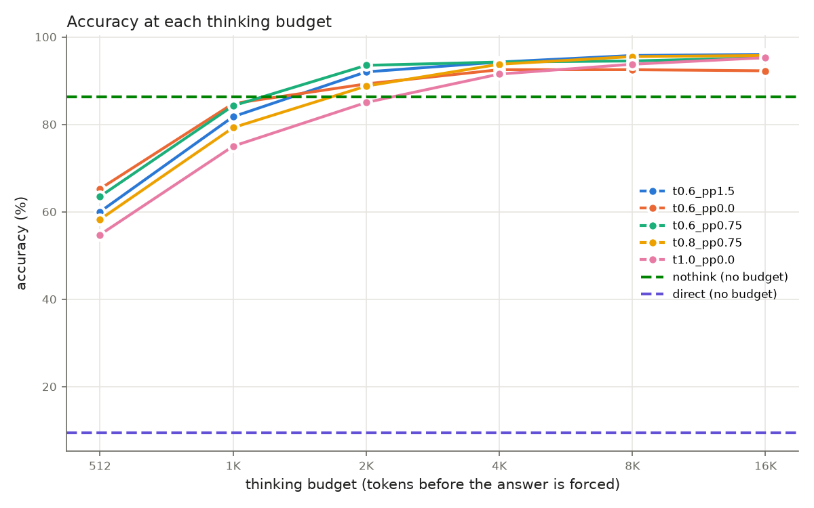

| Config | 512 | 1K | 2K | 4K | 8K | 16K |
|---|---|---|---|---|---|---|
| **t0.6_pp1.5** | 60.0 | 81.8 | 92.0 | 94.2 | 95.8 | **96.0** |
| t0.6_pp0.0 | **65.2** | **84.8** | 89.2 | 92.5 | 92.5 | 92.0 |
| t0.6_pp0.75 | 63.5 | 84.2 | **93.5** | 94.2 | 94.5 | 95.2 |
| t0.8_pp0.75 | 58.2 | 79.2 | 88.8 | 93.8 | 95.5 | 95.8 |
| t1.0_pp0.0 | 54.8 | 75.0 | 85.2 | 91.2 | 93.5 | 95.0 |
| nothink | 86.2 (no budget) | | | | | |

- Every config rises steeply up to 2K, then flattens. The ranking changes with the budget:
  - **small budgets (512–1K):** a lower presence penalty is better. pp0.0 and pp0.75 lead by 2–5 points.
    The penalty seems to slow the model down early (it avoids reusing the question's own numbers and words).
  - **large budgets (8K–16K):** pp1.5 leads. pp0.0 stops improving at 4K because its traces start looping.
- A higher temperature is worse at every small budget: t1.0 trails t0.6 by 5–7 points up to 2K.
- `nothink` (86.2%) beats every thinking config at 1K or less. It is beaten from 2K on by
  every config except t1.0 (85.2% at 2K), and by all of them from 4K on.

### 2. Accuracy against cost

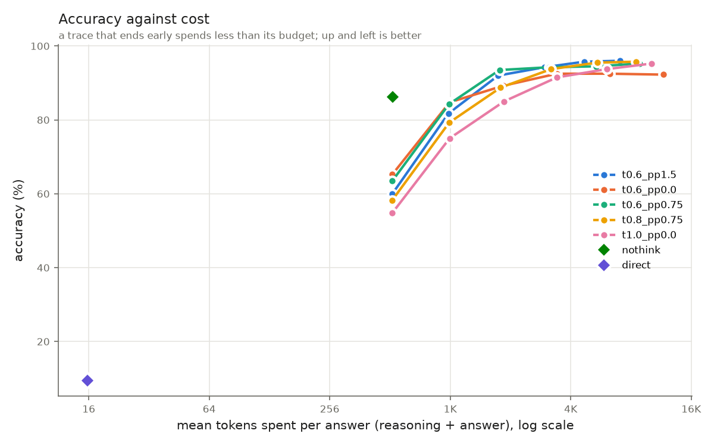

Mean tokens actually spent at each cut. A trace that ends early spends less than its budget, so
these are lower than the cut.

| Config | 512 | 1K | 2K | 4K | 8K | 16K |
|---|---|---|---|---|---|---|
| t0.6_pp1.5 | 527 | 1,005 | 1,780 | 3,029 | 4,787 | **7,245** |
| t0.6_pp0.0 | 527 | 1,018 | 1,889 | 3,501 | 6,423 | 11,900 |
| t0.6_pp0.75 | 527 | 1,010 | 1,808 | 3,210 | 5,502 | 9,073 |
| t0.8_pp0.75 | 525 | 1,012 | 1,830 | 3,277 | 5,559 | 8,669 |
| t1.0_pp0.0 | 525 | 1,017 | 1,903 | 3,497 | 6,218 | 10,407 |
| nothink | 527 (mean), 395 (median) | | | | | |

- t0.6_pp1.5 is the cheapest at every budget from 2K up, because more of its traces stop by themselves.
- **Efficiency of the winner:** 92.0% for 1,780 tokens (2K), 95.8% for 4,787 (8K), 96.0% for 7,245 (16K).
  The last 0.2 points cost 2,458 tokens per answer.
- `nothink` costs about as much as a 512-token budget but scores 26 points higher. Without the
  `<think>` block the model still writes a short worked solution in its answer.

### 3. How long the model thinks

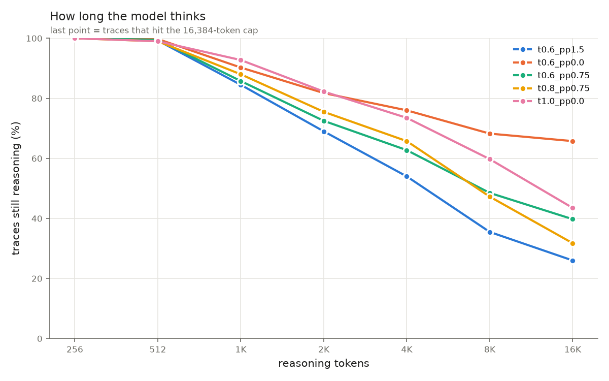
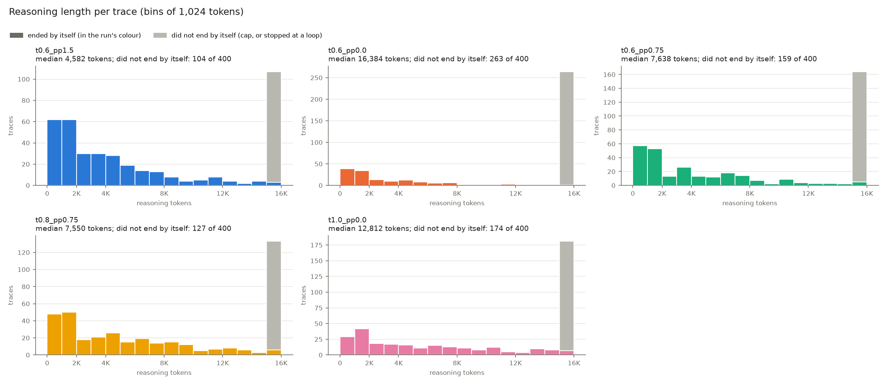

| Config | Median reasoning | Ended by itself | Hit the cap |
|---|---|---|---|
| **t0.6_pp1.5** | **4,582** | **74.0%** | 104 / 400 |
| t0.8_pp0.75 | 7,550 | 68.2% | 127 / 400 |
| t0.6_pp0.75 | 7,638 | 60.2% | 159 / 400 |
| t1.0_pp0.0 | 12,812 | 56.5% | 174 / 400 |
| t0.6_pp0.0 | 16,384 (cap) | 34.2% | 263 / 400 |

- The distribution has two parts: a spread of traces that end anywhere from a few hundred to about
  15K tokens, and a spike at the cap.
- Even the winner has a long tail. A quarter of its traces never conclude within 16K, and
  15.5% end within 1K.
- Share of traces already ended at each cut (winner): 0.8% at 512, 15.5% at 1K, 31% at 2K,
  46% at 4K, 64.5% at 8K, 74% at 16K.

### 4. Does the way a trace ends predict the answer?

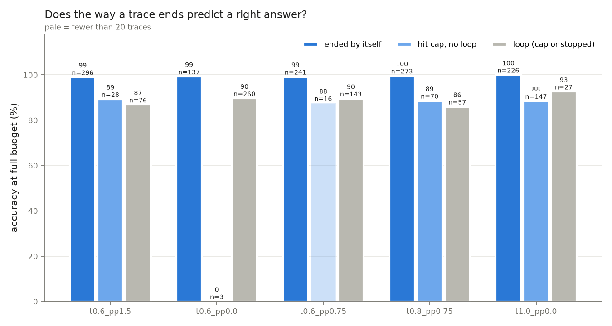

Full-budget accuracy, with the number of traces in brackets:

| Config | Ended by itself | Hit cap, no loop | Hit cap, loop |
|---|---|---|---|
| t0.6_pp1.5 | 99.0 (296) | 89.3 (28) | 86.8 (76) |
| t0.6_pp0.0 | 99.3 (137) | 0.0 (3) | 89.2 (260) |
| t0.6_pp0.75 | 99.2 (241) | 87.5 (16) | 89.5 (143) |
| t0.8_pp0.75 | 99.6 (273) | 88.6 (70) | 86.0 (57) |
| t1.0_pp0.0 | 100.0 (226) | 87.1 (147) | 96.3 (27) |

- **A trace that ends by itself is almost always right (99–100%).** "The model concluded" is
  a strong signal.
- Traces that hit the cap are still 86–96% right. The model usually has the answer and then keeps
  re-checking it. So the extra tokens are wasted rather than harmful.
- There are two ways to fail to conclude. With pp0.0 it is **word-for-word loops** (260 of 263
  capped traces). At t1.0 it is **rambling without loops** (147 of 174). The penalty and the
  temperature each break loops, but the model then rambles instead.

### 5. Loops

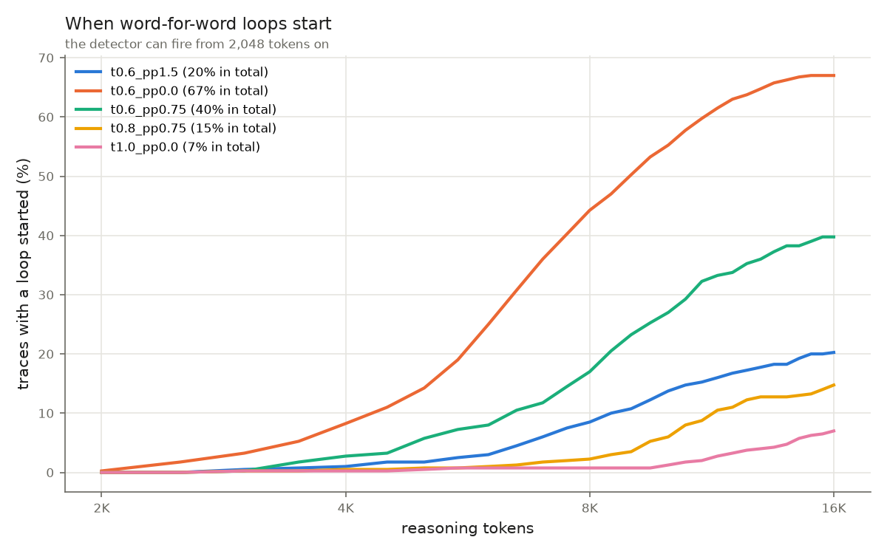

| Config | Traces with a loop | Started by 4K | Started by 8K | Median start | Loops in traces that still ended |
|---|---|---|---|---|---|
| t0.6_pp0.0 | 268 (67%) | 33 | 177 | 6,912 | 8 |
| t0.6_pp0.75 | 159 (40%) | 11 | 68 | 8,704 | 16 |
| t0.6_pp1.5 | 81 (20%) | 4 | 34 | 8,960 | 5 |
| t0.8_pp0.75 | 59 (15%) | 2 | 9 | 10,752 | 2 |
| t1.0_pp0.0 | 28 (7%) | 1 | 3 | 12,544 | 1 |

- Loops start late. Before 4K they are rare, even without a penalty. The median start is 7K–12.5K tokens.
- Both a higher penalty and a higher temperature make loops rarer and later.
- **False flags:** 1–16 traces per config were flagged but still ended by themselves. A loop guard
  would cut these off, so the exact replay must check whether they were right.

### 6. Does more thinking fix or break answers?

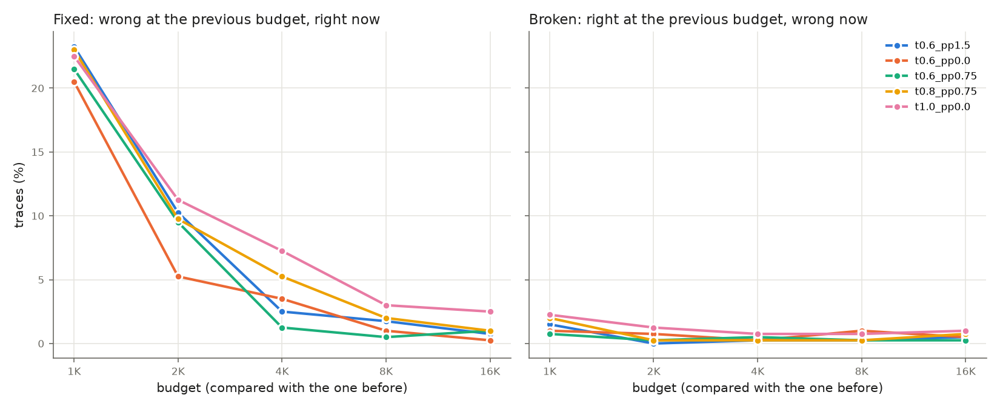

Share of traces whose answer changes between one budget and the next (winner):

| Step | 512→1K | 1K→2K | 2K→4K | 4K→8K | 8K→16K |
|---|---|---|---|---|---|
| fixed (wrong → right) | 23.2% | 10.2% | 2.5% | 1.8% | 0.8% |
| broken (right → wrong) | 1.5% | 0.0% | 0.2% | 0.2% | 0.5% |

- Most wrong → right changes happen below 2K. From 4K on, under 2% of traces change per step, and
  the two directions nearly cancel out.
- **Over-thinking is rare:** only 3–9 traces per config (≤ 2.3%) were right at some smaller
  budget and wrong at 16K. t1.0 has the most breaks (2.2% at the first step), and pp0.0 has the
  most over-thought traces (9).

### 7. How much thinking the questions need

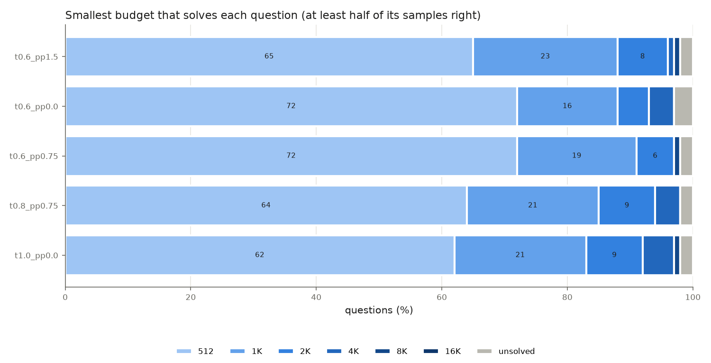

The smallest budget at which at least 2 of the 4 samples are right, as a number of questions out of 100:

| Config | 512 | 1K | 2K | 4K | 8K | 16K | unsolved |
|---|---|---|---|---|---|---|---|
| t0.6_pp1.5 | 65 | 23 | 8 | 1 | 1 | 0 | 2 |
| t0.6_pp0.0 | 72 | 16 | 5 | 4 | 0 | 0 | 3 |
| t0.6_pp0.75 | 72 | 19 | 6 | 0 | 1 | 0 | 2 |
| t0.8_pp0.75 | 64 | 21 | 9 | 4 | 0 | 0 | 2 |
| t1.0_pp0.0 | 62 | 21 | 9 | 5 | 1 | 0 | 2 |

- **Most questions are easy for this model.** About two thirds are solved at 512 tokens and
  83–91% by 1K. No question needs 16K.
- This is the key fact for the RL work. The model thinks for a median of 4.6K–16K tokens, while
  most questions need about 1K. That gap is the room for an effort controller.
- One question (`gsm8k-train-6914`, the YouTube question, reference 65) was never answered right
  by any thinking config. Its wording is ambiguous: "does this a total of 5 times before he
  finally finds" can be read as 4 or 5 failed lists. The model answers 75, 5 or 15. It is probably
  a dataset problem, not a model one.

### 8. Is a confident answer a right answer?

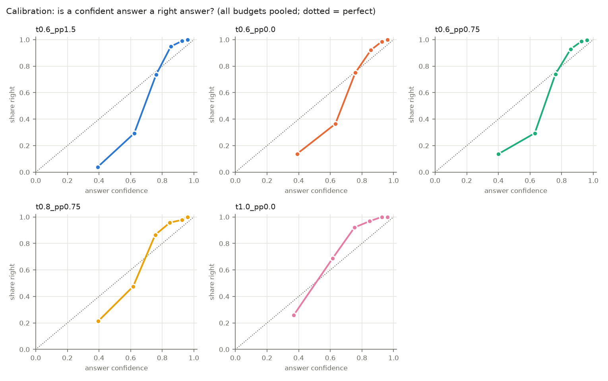
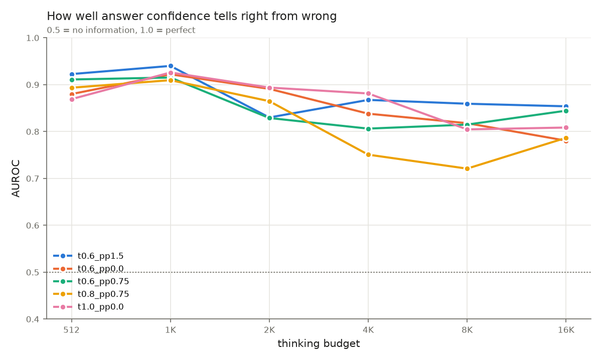

Calibration of the winner (all budgets pooled; confidence = exp of the mean log-probability of
the answer tokens):

| Confidence | 0–0.5 | 0.5–0.7 | 0.7–0.8 | 0.8–0.9 | 0.9–0.95 | 0.95–0.99 |
|---|---|---|---|---|---|---|
| answers | 26 | 222 | 345 | 777 | 812 | 218 |
| right | 4% | 29% | 74% | 95% | 99% | 100% |

- The curve is steeper than the diagonal. The model is **over-confident when unsure** (0.5–0.7
  confidence → 29% right) and **under-confident when sure** (0.8–0.9 → 95% right). Above 0.8
  confidence, the answer is almost always right.
- AUROC per budget (winner): 0.92 / **0.94** / 0.83 / 0.87 / 0.86 / 0.85. The signal is best
  at small budgets (512–1K) and weaker from 2K on, where fewer answers are wrong and the remaining
  errors are harder to tell apart.
- AUROC at the full budget for all configs: 0.79–0.85. That makes confidence a useful input for an
  effort controller ("stop thinking when the forced answer is confident").

### 9. Agreement between samples

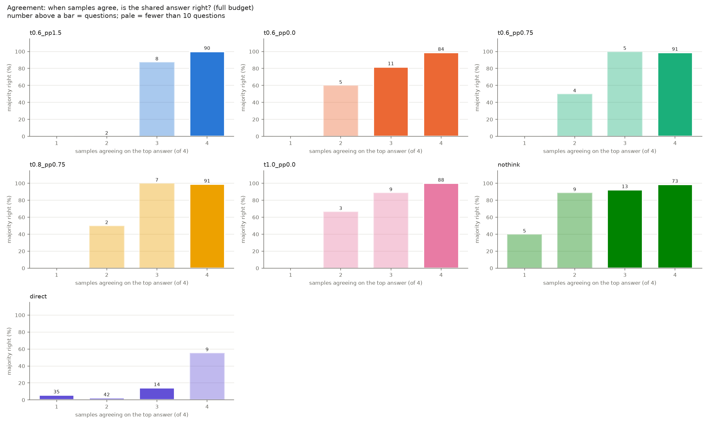

Number of questions, and the share whose majority answer is right:

| Config | 4 of 4 agree | 3 of 4 | 2 of 4 | 1 of 4 |
|---|---|---|---|---|
| t0.6_pp1.5 | 90 → 100% | 8 → 88% | 2 → 0% | 0 |
| t0.6_pp0.0 | 84 → 99% | 11 → 82% | 4 → 50% | 1 → 100% |
| t0.6_pp0.75 | 91 → 99% | 5 → 100% | 4 → 50% | 0 |
| t0.8_pp0.75 | 91 → 99% | 7 → 100% | 2 → 50% | 0 |
| t1.0_pp0.0 | 87 → 100% | 10 → 90% | 3 → 67% | 0 |
| nothink | 73 → 99% | 13 → 92% | 9 → 89% | 5 → 40% |

- When all 4 samples agree (84–91% of questions with thinking), the answer is right 99–100% of
  the time. Unanimity is a near-perfect correctness signal.
- With thinking, a split vote is rare and is then often wrong.

### 10. Headline numbers at the full budget

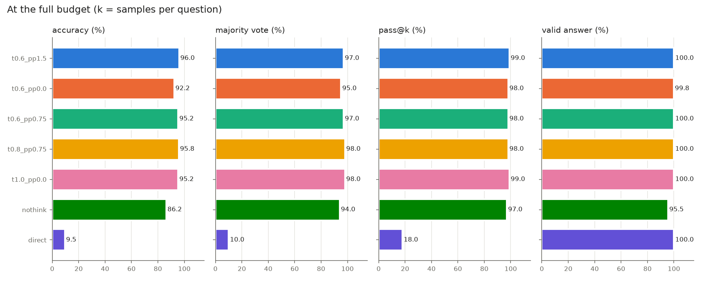

| Config | Accuracy | Majority of 4 | pass@4 | Valid answer |
|---|---|---|---|---|
| **t0.6_pp1.5** | **96.0** | 97.0 | 99.0 | 100.0 |
| t0.8_pp0.75 | 95.8 | **98.0** | 98.0 | 100.0 |
| t0.6_pp0.75 | 95.2 | 97.0 | 98.0 | 100.0 |
| t1.0_pp0.0 | 95.0 | 98.0 | 99.0 | 100.0 |
| t0.6_pp0.0 | 92.0 | 95.0 | 98.0 | 99.8 |
| nothink | 86.2 | 94.0 | 97.0 | 95.5 |

- Majority voting adds 1–3 points with thinking and 8 points without it.
- pass@4 is 97–99% everywhere. The model can solve nearly every dev question; the question is how
  reliably and at what cost.
- `nothink` gives no boxed answer in 4.5% of cases. It writes past its 2,048 tokens without
  concluding, and those cases count as wrong. Among its valid answers it is 90.3% right.

### 11. Stopping on loops (rough estimate)

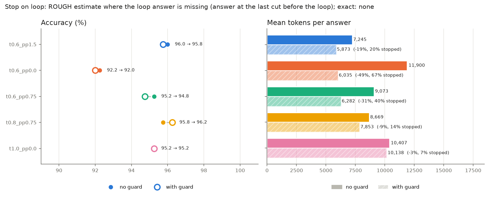

| Config | Accuracy, no guard → guard | Tokens, no guard → guard | Traces stopped |
|---|---|---|---|
| **t0.6_pp1.5** | 96.0 → 95.8 | 7,245 → 5,873 (−19%) | 20% |
| t0.6_pp0.0 | 92.0 → 92.0 | 11,900 → 6,035 (−49%) | 67% |
| t0.6_pp0.75 | 95.2 → 94.8 | 9,073 → 6,282 (−31%) | 40% |
| t0.8_pp0.75 | 95.8 → 96.2 | 8,669 → 7,853 (−9%) | 14% |
| t1.0_pp0.0 | 95.0 → 94.8 | 10,407 → 10,138 (−3%) | 7% |

- **This is an estimate.** A stopped trace is answered at the last recorded cut *before* its loop
  point, not at the loop point itself, which is pessimistic. The exact replay needs the forced
  answer at the loop point, which is not recorded yet.
- For the winner: about a fifth fewer tokens for −0.2 points, which is within noise.
- With the guard, pp0.0 becomes as cheap as pp1.5 (6,035 against 5,873 tokens) but stays 4 points less accurate.
- The guard does nothing for rambling (t1.0): it only catches word-for-word repetition.

---

### 12. Three levels of reasoning: none, written, thinking

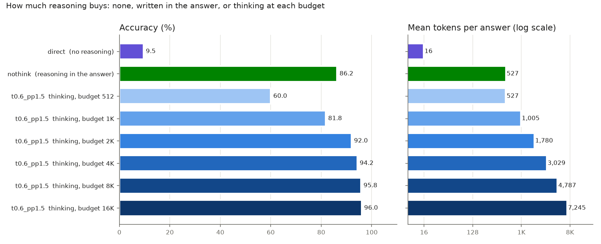

`nothink` turns the thinking block off, but the prompt asks for step-by-step reasoning, so the
model writes it in its answer (mean 527 tokens). `direct` removes the reasoning: the answer is
started with `The final answer is \boxed{` and the model only fills in the number.

| Config | Reasoning | Accuracy | Majority vote | pass@4 | Tokens |
|---|---|---|---|---|---|
| `direct` | none | **9.5** | 10.0 | 18.0 | 16 |
| `nothink` | written in the answer | 86.2 | 94.0 | 97.0 | 527 |
| `t0.6_pp1.5` at 512 | thinking, cut | 60.0 | | | 527 |
| `t0.6_pp1.5` at 16K | thinking, full | 96.0 | | | 7,245 |

- **Almost all of the accuracy comes from reasoning.** Without it, the 2B model guesses: 9.5%.
  Even 4 samples find the right number for only 18% of questions. The right ones are short questions
  of one or two steps (e.g. legs of 2 dogs and 1 chicken; Mario's age from a sum of 7).
- Every `direct` answer closed the box at once and then started to explain (*"Step-by-step
  Derivation:"*) until the 16-token limit. So the model "wants" to reason after answering, and
  the answer it wrote first was not based on any reasoning.
- **Written reasoning is the most efficient at small budgets:** at the same ~527 tokens,
  `nothink` gets 86.2% and a thinking trace cut at 512 gets 60.0%. A free, complete answer is
  worth more than a thinking trace cut off in the middle. Thinking only pulls ahead from 2K.
- Confidence still carries a little signal without reasoning: mean 0.78 for right answers
  against 0.69 for wrong ones.
- For RL: `direct` is the floor (9.5%), `nothink` the cheap baseline (86%, ~0.5K tokens),
  full thinking the ceiling (96%, ~7K tokens). A budget controller has to beat `nothink`'s
  cost/accuracy point to be worth it.

---

### What this means for the next steps

- **Final test run:** `t0.6_pp1.5`, with or without the loop guard (decide after the exact replay).
- **Budget for the test run:** stopping at 8K instead of 16K would cost about 0.2 points
  (95.8 against 96.0 on dev) and save about a third of the tokens (4,787 against 7,245), roughly
  halving the run time. That is worth considering if the test run is too slow.
- **For the RL controller:** most questions need about 1K tokens, but the model spends 4.6K
  (median). The available signals are strong:
  - the trace ended by itself (99% right);
  - a forced answer with confidence above 0.8 (95–100% right, AUROC up to 0.94 at small budgets);
  - samples that agree (99–100% right).
- **Caveats:** 100 questions; the dev set comes from the GSM8K train portion, so it may be a little
  easier than the test set; answers at a cut are forced; the loop guard numbers are estimates.


---

## 4. MATH (`generation_math/`)

Separate from `generation_gsm8k/`, but the **recording is the same as GSM8K's**, so every dataset has
one format and the controller (see `rl_methods/`) reads them all the same way. The LLM is frozen;
these recordings are the controller's replay data.

### What is the same as GSM8K

`src/run_math.py` imports these from `generation_gsm8k/src/` (not copies, so they cannot drift):

- the prompt, the forced-answer cue `</think> The final answer is \boxed{`, the server client;
- the configs: `t0.6_pp1.5` (the GSM8K winner) and `direct` (no reasoning);
- the loop rule and `--stop-on-loop` (2,048-token window, checked every 256, >10% repeated 20-grams);
- the seeds: `seed_for(question_id, sample)`;
- **the cuts: 256, 512, 1024, 2048, 4096, 6144, 8192, 12288, 16384**, plus one answer at the end
  of each trace. Answers exist only for the cuts a trace reached; the higher cuts are filled in from
  its end answer when the data is read (`expand_answers`). Nothing is stored after a trace's end.

Output files are the same: `traces.jsonl`, `answers.jsonl`, `end_answers.jsonl` in
`generation_math/data/results/<set>/<config>/`.

### What differs, and why

| Item | GSM8K | Here | Why |
|---|---|---|---|
| grader | number in the first box | **Math-Verify** on the first box, or equal normalised strings | answers are expressions: `\frac{\sqrt3}{2}`, `(-\infty,-2]\cup[3,\infty)`, `\text{(C)}` |
| `pred` | a number | the normalised box content (string) | used to group equal answers; `0.5` and `\frac12` are graded equal but grouped apart (the converter can merge them with Math-Verify) |
| forced answer length | 16 tokens | **32** | longer answers; confidence is still on the box only (`box_tokens`, `box_confidence`), and `box_closed` says whether the box closed |
| samples per question | 10 | **10** (`--samples 10`; the script default is 6, the minimum an episode needs) | the same as GSM8K, so every dataset has 10 traces per question |
| long prompts | error | skipped and listed | a few MATH prompts may not fit 17,408 − 16,384 |
| trace rows | | + `level`, `subject` | to report per difficulty level |

### Sets (`src/prepare_math.py`)

| Set | Questions | Source | Use |
|---|---|---|---|
| `math_pilot` | 20 (4 per level) | MATH train | first: real trace lengths and accuracy |
| `math_train` | 400 (80 per level 1–5, subjects interleaved) | MATH train | controller train |
| `math_val` | 100 (20 per level) | MATH train, no overlap | controller validation |
| `math_test` | 200 of MATH-500, stratified by level | MATH test | controller test |
| `math500` | 500 | MATH test (standard subset) | optional: the full standard set (contains `math_test`) |

Sizes: `--train-per-level`, `--val-per-level`, `--pilot-per-level`, `--test-size`; `--only` writes a
subset. MATH train comes from the local cache; MATH-500 (`HuggingFaceH4/MATH-500`) is downloaded the first time (a few hundred kB). Existing files are never
overwritten.

### Commands

**1. Write the sets**

```bash
~/.venvs/vllm/bin/python generation_math/src/prepare_math.py
```

**2. Server**: the same as for GSM8K (16K traces need at least 17,408).

```bash
LLM_MAX_LEN=17408 LLM_GPU_UTIL=0.90 LLM_MAX_SEQS=64 llm serve
```

**3. Pilot first** (20 questions × 6): measures trace lengths, how often traces hit 16K, and the
accuracy per level and cut.

```bash
~/.venvs/vllm/bin/python generation_math/src/run_math.py run --set math_pilot --configs t0.6_pp1.5 direct --samples 6 --stop-on-loop --concurrency 16
```

**4. The full recordings** (after looking at the pilot):

```bash
~/.venvs/vllm/bin/python generation_math/src/run_math.py run --set math_train --configs t0.6_pp1.5 direct --samples 10 --stop-on-loop --concurrency 16
```

```bash
~/.venvs/vllm/bin/python generation_math/src/run_math.py run --set math_val --configs t0.6_pp1.5 direct --samples 10 --stop-on-loop --concurrency 16
```

```bash
~/.venvs/vllm/bin/python generation_math/src/run_math.py run --set math_test --configs t0.6_pp1.5 direct --samples 10 --stop-on-loop --concurrency 16
```

AMC 2023 (and its optional 32K cap): see [AMC 2023](#5-amc-2023-generation_amc23).

**Report** (generates nothing):

```bash
~/.venvs/vllm/bin/python generation_math/src/run_math.py report --set math_pilot --configs t0.6_pp1.5 direct
```

Every run can be stopped (Ctrl-C) and started again: finished traces are skipped. Mixing
`--stop-on-loop` settings in one result folder is refused.

### Report columns

`acc@N` (one run, thinking limited to N tokens), `acc@direct`, `natural_pct` / `loop_stopped_pct` /
`cap_pct`, `median_reasoning`, `p95_reasoning`, `mean_tokens_at_top`, a table of accuracy per MATH
level and cut, and **`levels_L/M/H`**: the controller levels suggested by the rule

- H = the top cut;
- L / M = the first cut reaching 85% / 97% of the accuracy at H.

On the GSM8K dev numbers this rule gives L 1K, M 4K, H 16K, the levels already chosen there.
Levels are set from each dataset's **train** set (`math_train`), not from the test.

### Figures

The GSM8K plot script draws MATH sets too (same result files), into `figures/` at the repo root:
`figures/math_pilot/` and `figures/train_val_test/`: GSM8K, MATH and AMC in the same figures, each
train + val + test merged, with `15_effort_levels.png` (L/M/H by the rule per dataset, merged and
train only) and the levels in `analysis.csv`.

```bash
~/.venvs/vllm/bin/python generation_gsm8k/src/plot/plot_sweep.py --dataset both --set all
```

`--all` draws every group of GSM8K, MATH and AMC.

### Export for the controller

```bash
~/.venvs/vllm/bin/python generation_math/src/export_math_csv.py
```

Writes one CSV pair per set into `controller_data/` at the repo root (outside the benchmark
folders, next to the GSM8K files): `math_train_controller.csv` + `math_train_traces.csv` (split
train), the same for `math_val` (val) and `math_test` (test). The columns are the
GSM8K ones (`generation_gsm8k/src/export_controller_csv.py`), plus `level` and `subject`, joined on
`trace_id = "<question_id>#<sample>"`. A set not recorded yet is skipped; a set still recording is
exported up to its last finished trace. Other sets: `--sets math_pilot:train`.


---

## 5. AMC 2023 (`generation_amc23/`)

AMC 2023 has 40 competition questions. It is recorded **once**, then split **by question** at
export. The scripts run `generation_math/src/*.py` with the data folder set to
`generation_amc23/data/` (`src/paths_amc23.py`), so prompt, configs, loop stop, grader and CSV
columns are the same as MATH.

| Item | AMC 2023 | GSM8K / MATH |
|---|---|---|
| Traces per question | 10 (40 x 10 = 400 traces) | 10 |
| Reasoning cap | **32,768** | 16,384 |
| Cuts | the 9 standard cuts + **24,576, 32,768** | 256 ... 16,384 |
| Server context | **33,792** (`LLM_MAX_SEQS=32`, client concurrency 8) | 17,408 |
| Split | seed-2026 shuffle: test 8, val 8, train 24 questions (80 / 80 / 240 traces) | see section 6 |

```
generation_amc23/
├── data/
│   ├── amc23.jsonl                 all 40 questions (the recorded set)
│   ├── amc23_train/val/test.jsonl  24 / 8 / 8 questions
│   └── results/amc23/<config>/     the one recording
└── src/
    ├── paths_amc23.py              points the MATH code at data/ here
    ├── prepare_amc23.py            writes the question and split files
    ├── run_amc23.py                run_math.py with 10 samples and the 32K cap
    └── export_amc23_csv.py         -> controller_data/amc23_{train,val,test}_controller.csv + _traces.csv
```

Traces of one question are correlated, so the effective test size is 8 questions: AMC test scores
have wide uncertainty and should be bootstrapped over questions.

---

## 6. Splits, controller CSVs, figures, effort levels

### Splits (by question: all traces of a question are in one split)

| Dataset | train | val | test | Source |
|---|---|---|---|---|
| GSM8K | 919 | 200 | 200 | the 1,319 GSM8K **test** questions, seed-2026 shuffle |
| MATH | 400 | 99 (+1 too long) | 200 | train/val: MATH **train** portion, 80/20 per level; test: MATH-500, 40 per level |
| AMC 2023 | 24 | 8 | 8 | all 40 questions, recorded once (10 traces each, 32K cap), seed-2026 split |

`math_test` has the same level mix as train (20% each), not MATH-500's (more level 4–5), so its
score is not the official MATH-500 number. Train and test accuracy agree per level, so the splits
come from one distribution.

### Controller CSVs (`controller_data/`)

One pair per set, joined on `trace_id = "<question_id>#<sample>"`; see `controller_data/README.md`
for the files and columns:
- `<set>_controller.csv`: one row per (trace, budget); budget 0 = `direct`;
- `<set>_traces.csv`: one row per trace, with its full reasoning text.

Both carry the model (name, family, size, architecture, config.json values) and every generation
setting.

### Embeddings (`controller_data/embeddings/`)

Question, reasoning and answer embeddings come from `all-MiniLM-L6-v2` (384 dims). PCA to 64 dims is fitted on
train only. Both versions are kept; see `controller_data/README.md` for the files. All four controllers take the
64-dim PCA question embedding as `q_emb`. Parameters: BANDIT 9,650, OPEN_LOOP 9,641, CLOSED_LOOP_API 10,025, CLOSED_LOOP_FULL 10,345.

```bash
~/.venvs/vllm/bin/python controller_data/build_embeddings.py
```

### Figures (`figures/`)

The final figures for all datasets are drawn once, after every generation is finished.

Drawn by `generation_gsm8k/src/plot/plot_sweep.py`:

| Folder | What |
|---|---|
| `figures/gsm8k_config_exp/` | the GSM8K config sweep (section 3) |
| `figures/math_pilot/` | the 20-question MATH pilot |
| `figures/amc23/` | AMC 2023, all 40 questions |
| `figures/train_val_test/` | GSM8K, MATH and AMC in the same figures, each train + val + test merged, with `15_effort_levels.png` |

### Effort levels (rule; merged train + val + test = train only)

**A level is a capped run.** The model thinks until it ends by itself, loops, or reaches the level's budget; only in
the last case is the answer forced at the cut. Level names are shared, and each dataset has its own caps. The controller
picks a name and never sees a dataset id; the environment translates the name into that dataset's cap. A new domain or
closed model needs its caps calibrated on a small sample first.

H = top cut; L / M = first cut reaching 85% / 97% of acc@H.

| Dataset | L | M | H | acc@H |
|---|---|---|---|---|
| GSM8K | 2K | 4K | 16K | 90.3 |
| MATH | 4K | 12K | 16K | 82.9 |
| AMC 2023 | 12K | 24K | 32K | 63.2 |

GSM8K's L is 2K on the 1,319 questions (acc@1K 74.0 < 76.8); MATH's M is close to the line
(acc@8K 79.8 against 80.4). AMC has 40 questions, so its levels are coarse; train alone gives the same three.
